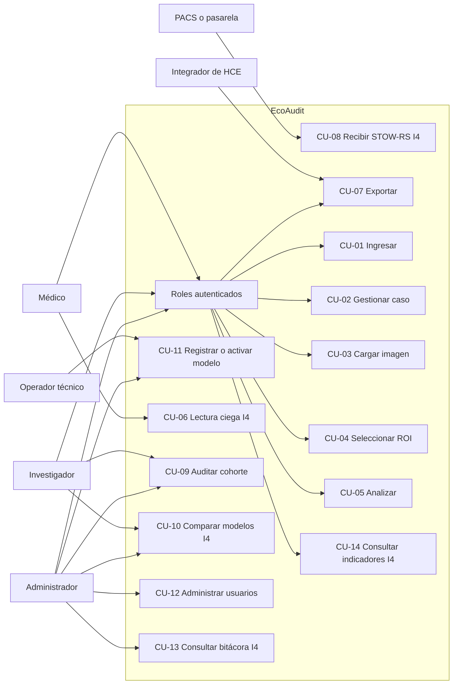

# Casos de uso

Las rutas usan el prefijo `/api`. Los recursos clínicos ordinarios se limitan al propietario, con acceso transversal para administración. Los flujos I4 incluyen condiciones operativas para el piloto y deben cotejarse con el contrato integrado.

### CU-01. Iniciar sesión · RF-01, RF-10

- **Actor y precondiciones.** Usuario con cuenta habilitada.
- **Flujo básico.** Introduce correo y contraseña en la pantalla de ingreso. `POST /auth/login` recibe formulario OAuth2 con `username` y `password`. El cliente guarda el JWT en `sessionStorage` y obtiene el perfil en `GET /auth/me`.
- **Alternos.** Credenciales inválidas o cuenta inactiva rechazan el ingreso. Cinco fallos previos en 15 minutos para el correo normalizado producen `429`. En Mi cuenta, `POST /auth/password` cambia la contraseña y revoca los tokens anteriores.
- **Postcondición.** Sesión habilitada con el rol vigente o acceso denegado.

### CU-02. Gestionar caso · RF-02

- **Actor y precondiciones.** Cualquier rol autenticado. El actor dispone de un seudónimo sin identificadores directos.
- **Flujo básico.** Abre Casos, crea el caso con seudónimo y notas opcionales y abre su detalle. La API usa `GET/POST /cases` y `GET /cases/{case_id}`.
- **Alternos.** Datos inválidos impiden el alta. Un caso ajeno responde `404` salvo para administración.
- **Postcondición.** Caso asignado a la cuenta creadora y disponible para cargar imágenes.

### CU-03. Cargar imagen · RF-03

- **Actor y precondiciones.** Usuario con acceso al caso y archivo revisado para descartar identificación visible.
- **Flujo básico.** Selecciona archivos. El visor los envía individualmente a `POST /cases/{case_id}/images`. El servidor decodifica, reconstruye el PNG, calcula huellas y banderas, guarda y audita.
- **Alternos.** Archivo demasiado grande (`413`), inválido o no decodificable (`422`). Un duplicado de carga individual genera aviso. Si una de varias solicitudes falla, pueden quedar otras imágenes cargadas.
- **Postcondición.** Imagen aceptada visible con sus avisos y origen.

### CU-04. Trazar o sugerir ROI · RF-04

- **Actor y precondiciones.** Usuario con acceso a una imagen cargada. La sugerencia requiere `roi/segmenter.onnx`.
- **Flujo básico.** Dibuja un rectángulo o usa **Sugerir ROI experimental**, que llama a `POST /images/{image_id}/roi`. Revisa el recuadro en el visor y lo acepta al solicitar el análisis.
- **Alternos.** Si el localizador falta (`503`) o no produce caja utilizable, traza manualmente o analiza la imagen completa. La API rechaza una caja inválida al solicitar análisis.
- **Postcondición.** Selección editable en el visor hasta su envío. La solicitud guarda la caja final.

### CU-05. Solicitar análisis · RF-05

- **Actor y precondiciones.** Usuario con acceso a imagen y versión activa.
- **Flujo básico.** Elige analizar imagen o ROI. `POST /images/{image_id}/analyses` devuelve `202` y fija la versión. El visor consulta `GET /analyses/{analysis_id}`, muestra el resultado y carga el CAM protegido cuando existe.
- **Alternos.** Sin modelo activo, `409`. ROI inválido, `422`. El worker puede terminar en `failed`. Fuera de dominio e indeterminado son decisiones de abstención de un análisis `done`.
- **Postcondición.** Resultado o error asociado al análisis y versión de origen.

### CU-06. Registrar lectura clínica ciega · RF-12 · I4

- **Actor y precondiciones.** Médico lector o administrador autorizado en la API visible. Dos lectores reciben la misma unidad de evaluación mediante un mecanismo de acceso aprobado por el piloto. El control por propietario debe verificarse antes de asignar dos cuentas.
- **Flujo básico.** Cada lector visualiza la imagen sin información del modelo ni del otro lector durante la tarea y registra su categoría BI-RADS. `POST /analyses/{analysis_id}/reading` asocia la lectura con el usuario autenticado. `GET` por la misma ruta devuelve la lectura propia.
- **Alternos.** Lectura repetida por la misma cuenta y análisis devuelve `409`. Si se expone información que rompe el ciego, el par se excluye según el protocolo. El campo `blinded` declara la condición. La ruta de análisis y las descargas visibles pueden exponer la salida del modelo a un usuario autorizado.
- **Postcondición.** Una lectura por lector y análisis. El protocolo de doble lectura exige dos valoraciones válidas para incluir el par en el kappa.

### CU-07. Exportar FHIR o PDF · RF-06, RF-07, RF-13

- **Actor y precondiciones.** Usuario autorizado sobre un análisis o investigador/administrador sobre una cohorte para su PDF. Resultado terminado.
- **Flujo básico.** Solicita `GET /analyses/{analysis_id}/report` o `GET /cohorts/{cohort_id}/report` para PDF. En I4 solicita `GET /analyses/{analysis_id}/fhir` y obtiene un `Bundle` R4 de tipo `collection` para validación con la HCE de ensayo.
- **Alternos.** Sin resultado terminado, `409`. Acceso ajeno, `404` para un rol ordinario autorizado sobre su propio ámbito. El cliente de integración retiene un archivo rechazado por el validador y registra la causa con datos ficticios.
- **Postcondición.** Artefacto descargado. La exportación FHIR registra un evento y se entrega al consumidor para su validación.

### CU-08. Recibir estudio DICOMweb · RF-14 · I4

- **Actor y precondiciones.** PACS o pasarela de prueba autorizada. Seudonimización y sintaxis verificadas en origen.
- **Flujo básico.** Envía instancias mediante `POST /dicomweb/studies` bajo el contrato STOW-RS integrado. El receptor valida las instancias, incorpora las imágenes admitidas y devuelve un resultado que el emisor reconcilia.
- **Alternos.** Autorización ausente, parte inválida, sintaxis no admitida o error parcial. Interpretar HTTP y cuerpo según el contrato integrado antes de reenviar.
- **Postcondición.** Instancias aceptadas vinculadas a casos de investigación y archivos reconstruidos comprobables.

### CU-09. Auditar cohorte · RF-07

- **Actor y precondiciones.** Investigador o administrador con etiquetas 0/1, ambos grupos representados y seudónimo consistente por paciente. El lote nuevo requiere versión activa.
- **Flujo básico.** Carga CSV `analysis_id,label` a `POST /cohorts` o manifiesto `filename,patient_ref,label` e imágenes a `POST /cohorts/batch`. Consulta progreso y métricas por paciente y descarga PDF y CSV de ítems.
- **Alternos.** CSV de análisis con ajenos, pendientes, versiones mezcladas o imágenes duplicadas se rechaza. Lote inválido se rechaza antes del alta. Un análisis fallido puede cerrar el lote como `failed`.
- **Postcondición.** Cohorte persistida con versión, huella de entrada, ítems y resultado cuando corresponde.

### CU-10. Comparar versiones · RF-16 · I4

- **Actor y precondiciones.** Investigador o administrador con acceso a cohorte etiquetada y dos versiones admitidas.
- **Flujo básico.** Selecciona cohorte y versión alternativa. `POST /cohorts/{cohort_id}/reanalyze` recibe `model_version_id` y crea otra cohorte en `processing` con las mismas imágenes, ROI y etiquetas. Con ambas terminadas, `GET /cohorts/compare?a={id_a}&b={id_b}` compara las métricas y la diferencia de AUROC B − A.
- **Alternos.** Cohorte incompleta, versión no disponible o análisis fallidos. Registrar la política de inclusión pareada según el contrato y comprobar si la salida es comparable.
- **Postcondición.** Evidencia de comparación asociada a la cohorte y a ambas versiones.

### CU-11. Registrar y activar modelo · RF-08

- **Actor y precondiciones.** Operador con acceso a CLI y paquete conforme al contrato. Administrador autenticado para activar por interfaz.
- **Flujo básico.** Registra con `python -m app.cli register-model RUTA`. Valida la ficha, la reconstrucción de logits y la huella. Activa con `--activate` en CLI o mediante **Activar** (`POST /models/{model_id}/activate`).
- **Alternos.** Paquete inválido se rechaza. Un modelo de demostración solo sirve para recorrer el flujo. Un paquete de huella conocida reutiliza su registro.
- **Postcondición.** Nuevas solicitudes ordinarias seleccionan el modelo activo. Los análisis existentes conservan su referencia.

### CU-12. Administrar usuarios · RF-09

- **Actor y precondiciones.** Administrador autenticado.
- **Flujo básico.** Abre Usuarios, crea la cuenta (correo, nombre, contraseña inicial y rol), actualiza rol o estado o restablece la contraseña.
- **Alternos.** Correo existente devuelve `409`. Intentar quitarse el rol de administrador o desactivarse devuelve `400`. Una cuenta ordinaria carece de permiso.
- **Postcondición.** Cambio persistido y auditado. Tras restablecer la contraseña, el usuario debe ingresar de nuevo.

### CU-13. Consultar bitácora · RF-15 · I4

- **Actor y precondiciones.** Administrador autenticado y eventos previos.
- **Flujo básico.** Abre Bitácora y consulta `GET /audit-log` por usuario, acción o fecha. Coteja acción, entidad, actor cuando existe y fecha. Puede exportar la página con `GET /audit-log.csv`.
- **Alternos.** Sin coincidencias se muestra una lista vacía. El acceso de otras cuentas se deniega. Los eventos de CLI pueden carecer de usuario.
- **Postcondición.** Evidencia de acciones recuperada sin modificar los eventos.

### CU-14. Consultar indicadores · RF-11 · I4

- **Actor y precondiciones.** Usuario habilitado según el alcance del endpoint.
- **Flujo básico.** Consulta Panel y revisa actividad, tiempos y concordancia mediante `/stats/overview`, `/stats/performance` y `/stats/concordance`. Registra periodo y denominadores.
- **Alternos.** Los estadísticos de latencia sin observaciones y el kappa indefinido son nulos. Desempeño se limita a investigador y administrador. La concordancia visible compara lectura humana y modelo. Para estimar acuerdo entre los dos lectores se requiere el análisis del piloto.
- **Postcondición.** Indicadores disponibles para seguimiento del piloto.
