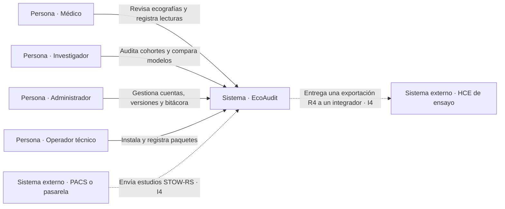
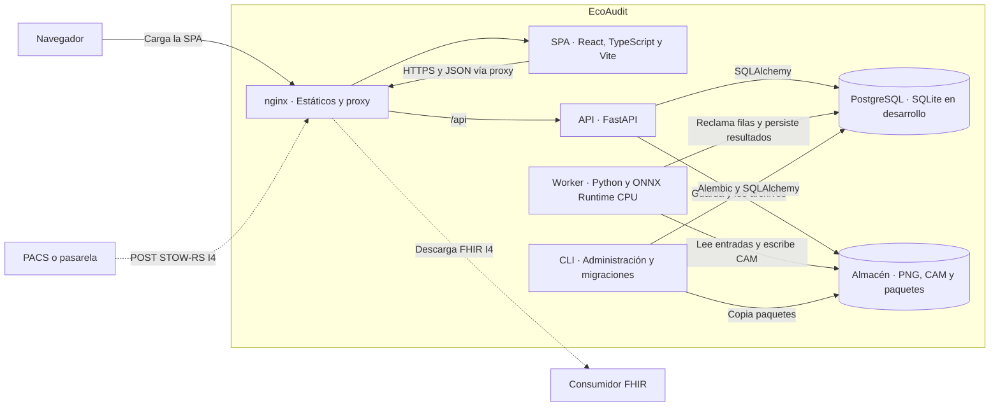
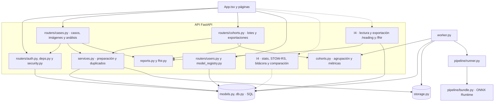
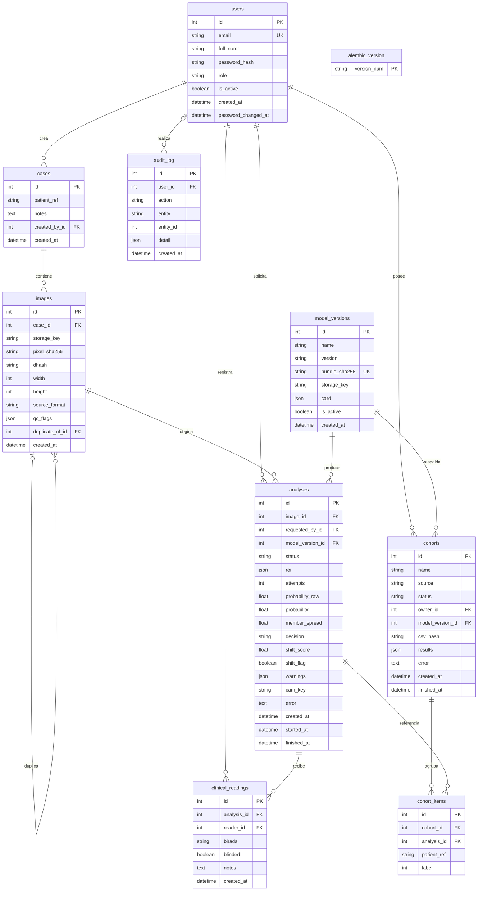
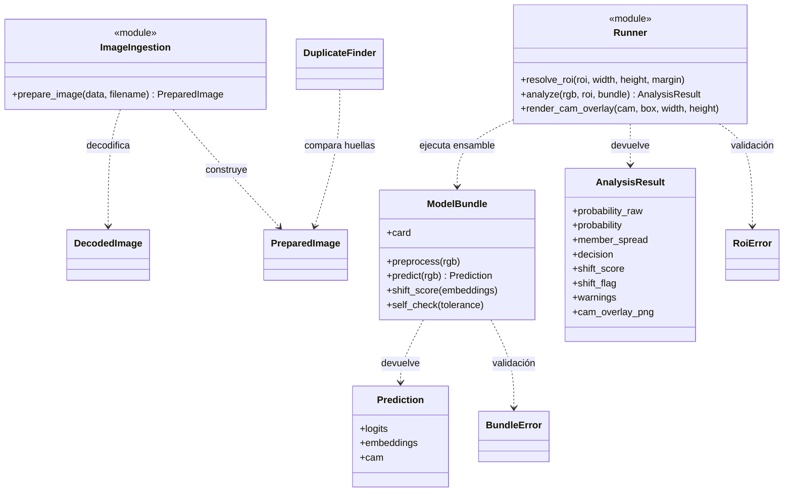
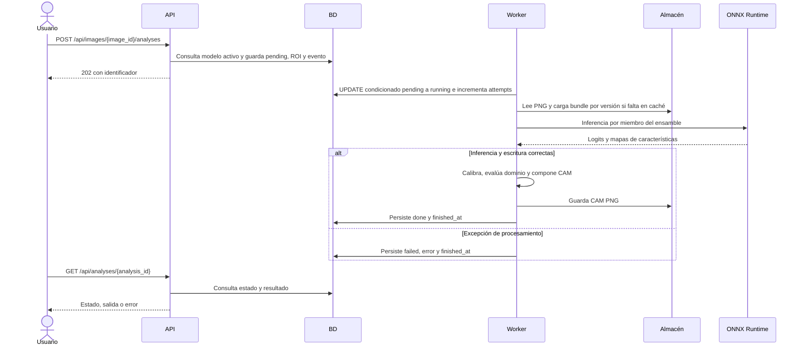
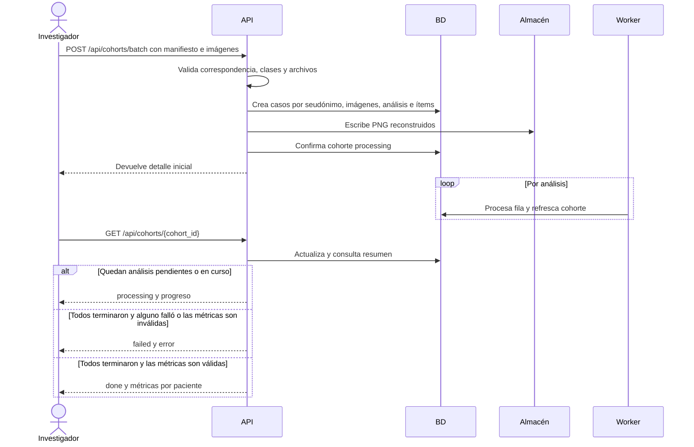
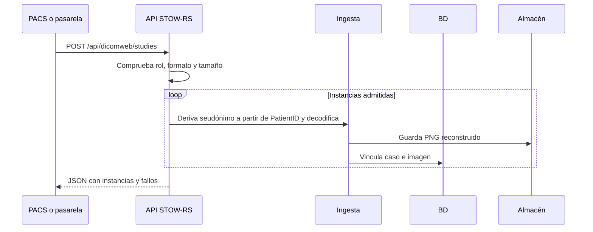
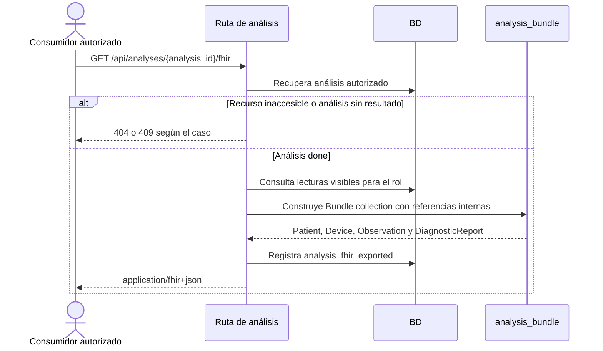
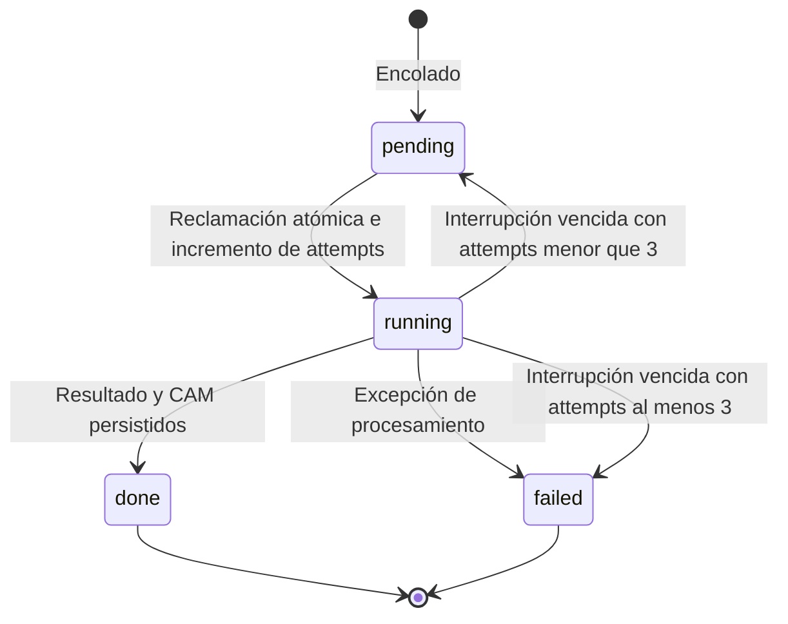

# Modelado de EcoAudit

Se utilizan tres vistas C4 en Mermaid. I4 señala el incremento de interoperabilidad, lectura independiente e indicadores. La SPA visible y las integraciones en desarrollo pueden encontrarse en revisiones distintas.

## C4 · Contexto

## C4 · Contenedores

En Compose el worker es un proceso separado. En desarrollo el modo inline ejecuta el mismo procesamiento en tareas de la API. El HTTPS se añade en un proxy de despliegue.

## C4 · Componentes

## Entidad–relación

Se representan las tablas de aplicación y la tabla técnica de Alembic. `audit_log.entity_id` es una referencia polimórfica sin FK. El par `clinical_readings(analysis_id, reader_id)` es único mediante `uq_reading_analysis_reader`. La FK al análisis tiene borrado en cascada. Los valores seudonimizados de `cohort_items.patient_ref` se copian para agrupar por paciente.

## Clases del pipeline

`runner.py` es un módulo. El promedio de logits se aplica antes de dividir por la temperatura. La alerta de dominio se decide por la referencia de vecinos coseno del paquete y prevalece sobre los umbrales de probabilidad. El CAM se reconstruye a partir de mapas y pesos de la cabeza lineal. [Contrato ONNX](../model-bundle.md)

## Secuencia · Análisis individual

## Secuencia · Auditoría por lote

## Secuencia · Recepción DICOMweb I4

El manejador visible admite cuenta médica o administradora, agrupa por seudónimo y dueño y responde `200` para recepción completa, `202` para parcial y `400` si ninguna instancia se acepta. El cliente de ensayo debe interpretar el JSON propio de EcoAudit. [Contrato de la API hospitalaria](../api-hospitalaria.md)

## Secuencia · Exportación FHIR I4

## Estados del análisis

`requeue_stale` usa `started_at` con un límite configurable de 300 s por defecto. El worker separado lo ejecuta en su bucle y la API al arrancar. `pending` conserva el contador en la recuperación. El diagrama recoge el reclamo atómico, sin atribuir al mecanismo una garantía de ejecución única frente a un trabajo que sigue vivo tras superar el tiempo de corte.
